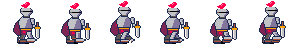
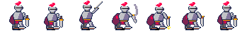
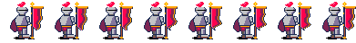

# Ring-knight animation trio — deepseek-v4.1-flash-low

Three 48×48 PICO-8 animations built with SpriteWare, sharing one armoured
standard-bearer design. Each `.aseprite` is the editable source; each `.gif`
plays at the authored frame durations. `_sheet.png` is a one-row contact sheet
and `_sheet.json` is the matching atlas.

| Test | Frames | Tag | Timing (ms) | What moves |
|---|---:|---|---|---|
| `march` | 6 | `walk`, forward, 1–6 | 140, 110, 90, 140, 110, 90 | Legs, one-pixel body bob, sword arm sway, cape lag |
| `strike` | 7 | `attack`, forward, 1–7 | 240, 140, 120, 40, 300, 110, 260 | Crouch, overhead wind-up, one-frame cut with smear, held impact, recoil |
| `banner` | 8 | `wave`, forward, 1–8 | 100, 90, 110, 100, 120, 90, 110, 130 | Cloth only; body, head, legs, arm, pole and shadow are identical every frame |

## Previews

### March

### Strike

### Banner

## Design decisions

- **View / rig.** Side-on knight facing right, built from separate `shadow`,
  `leg-far`, `arm-far`, `cape`, `body`, `head`, `leg-near`, `sword` and
  `arm-near` cels. The three pieces stay in the same family.
- **March.** Six-key cycle: contact, down, pass for each leg. The planted foot
  is held while the body drops 1 px on the down pose, rises 1 px on the pass,
  then the other leg takes over. The sword arm swings opposite the near leg
  and the cape trails by one pixel.
- **Strike.** Seven keys with deliberately asymmetric timing. Frame 3 is the
  full overhead wind-up, frame 4 is a 40 ms cut (with a solid steel smear, no
  alpha), frame 5 is the impact held for 300 ms — the longest held pose — and
  frame 6 is the recoil. Both feet stay planted in the lunge; the torso and
  head keep their volume and only translate.
- **Banner.** The left edge of the cloth is anchored to the pole; a travelling
  wave runs down the free right edge and into the tapered point. The body,
  head, legs, holding arm, pole and ground shadow are copied identically to
  all eight frames. Frame 8 is a 45° phase step from frame 1, not a repeat, so
  the loop continues instead of popping.

## Mechanical checks

All three documents were checked through SpriteWare `validate` with an explicit
palette and bounds expectation:

- palette: clean, 16 PICO-8 colours each;
- silhouette: every frame is a single 4-connected ink component;
- frame counts and tags match the pass bars above;
- timing varies in every clip;
- the strike's weapon, smear and hit spark stay inside the 48×48 canvas;
- the banner diff shows changes only on the cloth layer.

The stated bounds are the same for every frame of a clip:

| Clip | Bounds box |
|---|---|
| march | x 12–42, y 1–43 |
| strike | x 11–47, y 1–43 |
| banner | x 11–47, y 2–43 |

## Human-only notes

- **March:** the weight shift is carried by a 1 px hip/body drop on the down
  keys (frames 2 and 5), with the planted boot held flat. The near foot is
  drawn in five poses and the far foot in five poses, so the passing leg is
  not a mirrored copy.
- **Strike:** the impact is 7.5× longer than the cut frame, so the hit lands
  and holds rather than reading as a smooth arc. The smear is deliberately a
  solid, chunky steel band — no semi-transparent pixels.
- **Banner:** follow-through comes from the phase lag down the cloth: the
  bottom point is still moving after the upper field has turned. The cloth
  never crosses the body outline.
