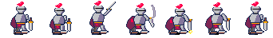
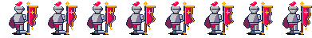

# Ring-knight animation trio — deepseek-v4.1-flash-max

The same three 48×48 PICO-8 benchmarks, taken through a longer animation pass.
The rig is the ring knight; the motion is authored separately from the
`flash-low` run.

| Test | Frames | Tag | Timing (ms) | What changed in this pass |
|---|---:|---|---|---|
| `march` | 8 | `walk`, forward, 1–8 | 140, 110, 90, 100, 140, 110, 90, 100 | Added the up/push-off keys between pass and contact, so the cycle has contact–down–pass–up for both legs |
| `strike` | 7 | `attack`, forward, 1–7 | 240, 130, 150, 40, 340, 110, 240 | Longer wind-up hold, deeper impact compression, 340 ms impact hold, sharper recovery |
| `banner` | 8 | `wave`, forward, 1–8 | 80, 100, 90, 120, 110, 130, 90, 140 | Gold cross emblem on the anchored panel, swinging tassel at the free point, new timing |

Every source is an `.aseprite` file with the animation already built. The
matching `.gif` plays at the durations above. `_sheet.png` is a one-row contact
sheet; `_sheet.json` is the atlas.

## Previews

### March

### Strike

### Banner

## Motion notes

- **March.** Eight frames rather than six: contact, down, pass and up for each
  leg. The new up keys put the trailing foot on its toe and send the leading
  foot forward, so the step lands instead of sliding. The body still drops one
  pixel on the down keys and rises on the pass keys.
- **Strike.** The 150 ms wind-up is held, then a 40 ms cut with the solid steel
  smear, then 340 ms of impact — the longest pose in the clip. The impact adds
  one more pixel of torso compression over the low run while the sword stays
  planted.
- **Banner.** The body, legs, holding arm, pole and shadow are identical on all
  eight frames. The cloth's left edge is anchored to the pole; the wave travels
  down the free right edge and into the tassel. The tassel's ball shifts one
  pixel behind the sheet's movement, adding follow-through at the free edge.

## Mechanical checks

`validate` is clean on all three sources with an explicit palette and bounds
expectation:

- 16 PICO-8 colours per sprite;
- every frame is one 4-connected ink silhouette;
- tags cover every frame, forward;
- frame lengths vary in every clip;
- strike weapon, smear and spark remain inside the 48×48 canvas;
- banner motion is confined to the `cloth` layer.

| Clip | Bounds box |
|---|---|
| march | x 11–42, y 1–43 |
| strike | x 11–47, y 1–43 |
| banner | x 11–47, y 2–43 |
