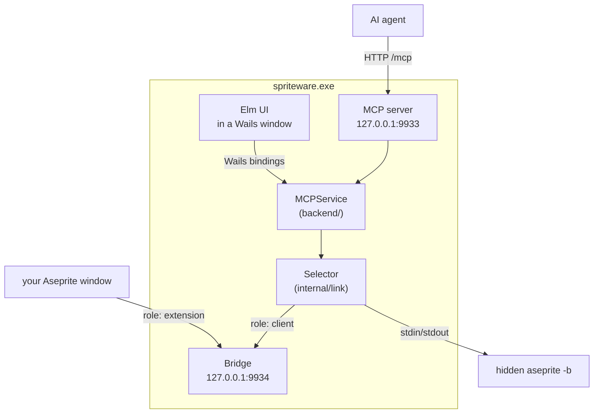

# Architecture

## Three programs in one window

**The UI** is Elm. It talks to Go through Wails: each Go method on `MCPService`
becomes a JavaScript function. The UI never touches Aseprite.

**The MCP server** is what an agent connects to. It carries twelve tools:
`doctor`, `sprite`, `layer`, `cel`, `frame`, `tag`, `draw`, `transform`, `look`,
`validate`, `palette`, `export`. It also serves the skill text as resources.

**The bridge** is a plain TCP socket. Two kinds of connection arrive on it:

- your Aseprite window, which says `{"role":"extension"}` and then sends results
- the tools, which say `{"role":"client"}` and then send commands

The tools dial the app's own bridge. That looks odd and is deliberate: the
bridge outlives the MCP server, so restarting the agent host does not drop your
open editor. [protocol.md](./protocol.md) has the details.

## The two ways to reach Aseprite

| | Live | Headless |
|---|---|---|
| Aseprite | the window you have open | a hidden `aseprite -b` process |
| Transport | TCP to the bridge (9934) | stdin and stdout of that process |
| Needs | the extension installed | nothing but the Aseprite binary |
| Good for | watching the agent draw | agents and CI with no human |

`internal/link` has two types, `Live` and `Headless`, behind one `Link`
interface. Tools do not know which one they got, so a command cannot behave
differently by accident. `Selector` holds both and switches on request; both
stay alive, so switching loses no documents.

Aseprite is auto-installed: `internal/aseprite` writes the extension into
`%APPDATA%\Aseprite\extensions\spriteware\` and bakes the bridge port into the
script, so the port in settings is the port it dials.

## One tool call, live mode

1. Agent sends `tools/call` for `draw` to `/mcp`.
2. `internal/tools` turns the arguments into one `draw.apply` command.
3. `Live` writes that JSON line to the bridge as a client.
4. The bridge stamps the call with the client's slot (`c1::r7`) and forwards it
   to the extension.
5. `spriteware.lua` draws on the sprite and replies.
6. The bridge strips the slot and routes the reply back to that client.
7. The tool returns the summary to the agent.

Headless mode is the same, with steps 3–6 replaced by a line on the child
process's stdin and a line back on its stdout.

## What owns what

| Thing | Owner | File |
|---|---|---|
| The tool surface and its schemas | `internal/tools` | `service.go` |
| Talking to Aseprite | `internal/link` | `live.go`, `headless.go` |
| The wire format | `internal/protocol` | `protocol.go` |
| The Aseprite-side code | `internal/luaext` | `extension/`, `headless/` |
| Linting the art | `internal/analyze` | `analyze.go` |
| Writing PNG, GIF, sheets | `internal/export` | `export.go`, `pack.go` |
| The bitmap font | `internal/font` | `font.go` |
| Settings | `internal/config` | `config.go` |
| The text agents read | `internal/skill` | `SKILL.md` and folders |
| Install buttons, paths | `backend` | `install.go`, `project.go` |
| Servers, lifecycle | `backend` | `mcp.go` |

## Settings and files

| What | Where |
|---|---|
| Settings | `%APPDATA%\SpriteWare\config.json` |
| Override the settings file | `SPRITEWARE_CONFIG` |
| Installed extension | `%APPDATA%\Aseprite\extensions\spriteware\` |
| Override that folder | `SPRITEWARE_EXTENSIONS_DIR` |

A hand-edited settings file is safe: a broken one is moved to
`config.bad.json` and replaced with defaults, and a UTF-8 BOM is ignored.
